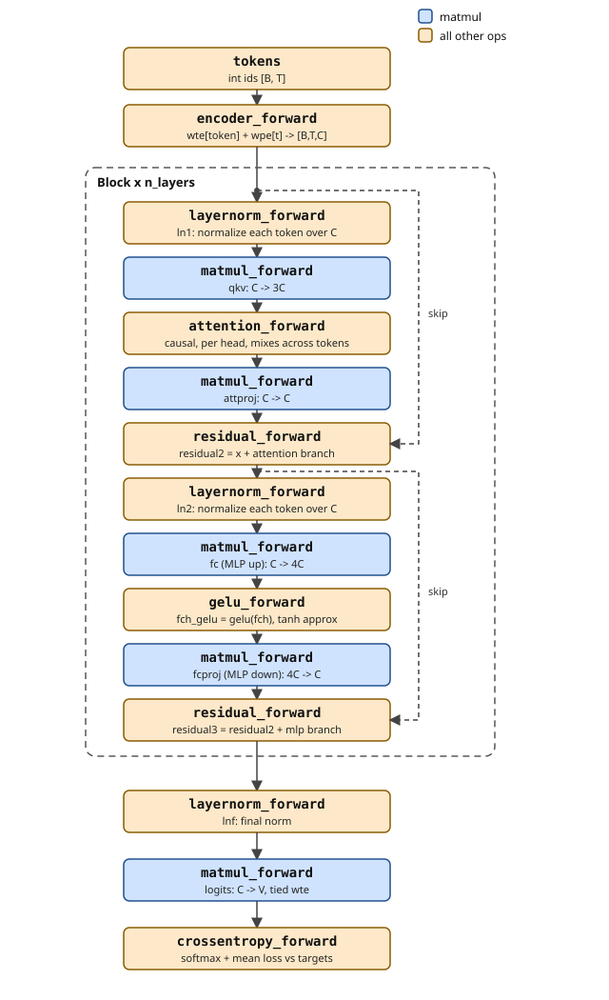

# The model

Decoder-only transformer, GPT-2 style. Everything below is what `serial` implements and what the MPI and CUDA versions must reproduce.

## Data and tokenizer

- TinyStories, filtered to stories with only printable ASCII (32-126) plus `'\n'`.
- BPE, 4096-token vocab: id 0 = end-of-story, ids 1-96 = base characters, the rest = learned merges. No unknown token, since every character has an id.
- Text is split into pieces first (a word with its leading space, a number, one punctuation mark, `'\n'`). Merges never cross a piece boundary.
- About 5M training tokens in `train.bin` (uint16 ids), plus a held-out `val.bin`.

## Config

`gpt_config_default` in `include/config.h`. Every shape in the model comes from these five fields.

| Field | Value |
|---|---|
| `vocab_size` (V) | 4096 |
| `max_seq_len` (Tm) | 256 |
| `n_layers` (L) | 6 |
| `n_heads` (NH) | 4 |
| `channels` (C) | 128 |

Derived: head size C / NH = 32, MLP hidden size 4C = 512.

## Parameters

Total **1,746,944**. Names are the fields of `ParameterTensors` in `include/model.h`; sizes are computed in `param_sizes` in `src/model.c`.

| Tensor | Shape | Count |
|---|---|---|
| `wte` | 4096 x 128 | 524,288 |
| `wpe` | 256 x 128 | 32,768 |
| 6 blocks x 198,272 | | 1,189,632 |
| `lnfw`, `lnfb` | 128 each | 256 |
| **Total** | | **1,746,944** |

One block (per-layer tensors are stacked, so `qkvw` is `[L, 3C, C]` and so on):

| Part | Tensors | Count |
|---|---|---|
| QKV | `qkvw` 384 x 128, `qkvb` 384 | 49,536 |
| attention projection | `attprojw` 128 x 128, `attprojb` 128 | 16,512 |
| MLP up | `fcw` 512 x 128, `fcb` 512 | 66,048 |
| MLP down | `fcprojw` 128 x 512, `fcprojb` 128 | 65,664 |
| two layernorms | `ln1w`, `ln1b`, `ln2w`, `ln2b` | 512 |
| **Block** | | **198,272** |

Layout (`include/ops.h`, `include/model.h`):

- Activations are `[B, T, C]`, row-major.
- Linear weights are `[C_out, C_in]`, so `wte` `[V, C]` works directly as the output layer.
- All parameters sit in one buffer (`params_memory`) and all gradients in a second with the same layout (`grads_memory`). MPI can allreduce it and CUDA can copy it in one call.

## Architecture

Sequential pre-LayerNorm blocks. `block_forward` in `src/model.c`:

```
x2 = x  + attproj(attention(qkv(ln1(x))))
x3 = x2 + fcproj(gelu(fc(ln2(x2))))
```

- **Positions:** learned `wpe`, added to the token embedding in `encoder_forward` (`src/cpu/encoder.c`).
- **Tied output layer:** `logits = lnf(x) @ wte^T`, the `matmul_forward(a->logits, a->lnf, w->wte, NULL, ...)` call in `gpt_forward`. `dwte` gets gradient from the output layer and from the encoder, and both are added.
- **GELU:** tanh approximation (`gelu_forward`, `src/cpu/gelu.c`).
- **Loss:** softmax and cross-entropy fused in `crossentropy_forward` (`src/cpu/crossentropy.c`), mean over all B*T positions.
- **Attention:** causal multi-head. A token attends to itself and earlier tokens only (`attention_forward`, `src/cpu/attention.c`).



Box titles are the function names in `include/ops.h`. Dashed arrows are the skip connections.

## Residuals

Each half-block sends x two ways: through the branch, and untouched around it (the skip). `residual_forward` (`src/cpu/residual.c`) adds them, so a branch only learns a change to x.

In backward, `residual_backward` sends the gradient down both paths and adds it where they meet. The skip path gives early layers a direct gradient route to the loss.

Nothing is copied in code. `layernorm_forward` reads x and writes a new buffer (`ln1`, `ln2`), so x stays intact for the residual add and for backward. For the same reason `residual_forward` output must not alias its inputs. Each result has its own slot in `ActivationTensors`: `residual2` is the first residual's output, `residual3` the second's and the next block's input.

## Ops per forward pass

| Op | Per block | Total (6 layers) | File |
|---|---|---|---|
| `matmul_forward` | 4 | 25 | `src/cpu/matmul.c` |
| `layernorm_forward` | 2 | 13 | `src/cpu/layernorm.c` |
| `residual_forward` | 2 | 12 | `src/cpu/residual.c` |
| `attention_forward` | 1 | 6 | `src/cpu/attention.c` |
| `gelu_forward` | 1 | 6 | `src/cpu/gelu.c` |
| `encoder_forward` | | 1 | `src/cpu/encoder.c` |
| `crossentropy_forward` | | 1 | `src/cpu/crossentropy.c` |

Matmul totals are 4 per block plus the output layer. They take about 90% of compute: QKV `C->3C`, attention output `C->C`, MLP up `C->4C`, MLP down `4C->C`, logits `C->V`.

Matmul mixes channels within a token. Attention is the only op that mixes information across tokens. Layernorm, gelu and residual treat each token independently.

## Backward pass

Same ops in reverse, each through its `_backward` function. `gpt_backward` (`src/model.c`) runs `crossentropy_backward`, the output `matmul_backward`, final `layernorm_backward`, `block_backward` for layers L-1 down to 0, then `encoder_backward`.

Every `_backward` accumulates (`+=`), so:

- parameter gradients are zeroed once per step by `gpt_zero_grad`, before `gpt_backward`;
- activation gradients are zeroed inside `gpt_backward`.

## Initialization

`init_params` in `src/model.c`:

- weights ~ N(0, 0.02);
- `attprojw` and `fcprojw` use 0.02 / sqrt(2 * n_layers). They write into the residual stream, so the smaller scale keeps it from growing with depth;
- layernorm weights 1, all biases 0.

The RNG is seedable xorshift64* with Box-Muller (`rng_seed`, `rng_normal` in `src/utils.c`), not `rand()`. The same seed gives identical weights on every machine, which is what makes the four versions comparable.

## Sanity checks

| Check | Result |
|---|---|
| Initial loss on random tokens | about 8.38, close to ln(4096) = 8.32 (uniform guessing) |
| Full-model finite-difference gradient check | all 16 parameter tensors match, about 4e-5 absolute error |
| Gradient descent on one tiny batch | loss 3.0 to 0.32 in 60 steps |
| One forward+backward, 256 tokens | about 0.8 s, single-threaded, `-O2` |

## Versus Pythia-14M

We copied its shape (6 layers, 128 channels, 4 heads, 4x MLP), not its architecture or parameter count.

| | Ours | Pythia-14M |
|---|---|---|
| Residual | sequential | parallel: `x + attn(ln1(x)) + mlp(ln2(x))` |
| Positions | learned `wpe` | rotary on 25% of each head's dims |
| Input/output tables | tied | untied |
| Vocab | 4,096 | 50,304 |
| Context | 256 | 2,048 |
| Head size | 32 | 32 |
| Parameters | 1.75M | about 14M |

Pythia's ~14M is about 92% vocab tables (two 50,304 x 128 tables = 12.9M). Its blocks are about the same 1.19M as ours.

Why we differ:

- a 4096 vocab fits TinyStories;
- tying halves the embedding cost;
- learned positions are simpler than RoPE;
- sequential blocks are slightly better at small scale.

A parallel residual would only change `block_forward` and `block_backward` in `src/model.c`. It is a possible later experiment, since the two branches could run on separate CUDA streams.

Why this size: training compute is about 6 x params x tokens, so at ~1.7M params the serial baseline stays practical. C = 256 would be about 5.8M params and ~3x the compute per token. Trying other shapes needs only a change to `gpt_config_default`.
