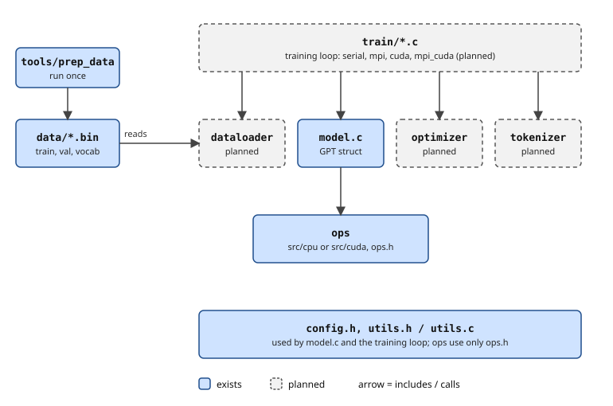

# Project structure

How the code is organized and how a training step moves through it. For the model itself (shapes, parameters, architecture) see [01-model.md](01-model.md).

## Core idea

Only the low-level math changes between the four versions. The model wiring, data loading and optimizer are the same in all of them.

## Layout

`(planned)` means the file is not written yet. Files marked `(empty)` exist but have no code.

```
.
├── Makefile                  (empty) targets: prep, serial, mpi, cuda, mpi_cuda, test
├── README.md
├── .gitignore                data/*.txt, data/*.bin, build/
├── .clangd                   editor setting: adds -Iinclude so Zed finds headers
├── data/                     TinyStories-train.txt, train.bin, val.bin, vocab.bin (not in git)
├── docs/
│   ├── 01-model.md, 02-structure.md
│   ├── transformer_training_loop_md.md
│   └── images/               forward-pass.svg, layers.svg
├── include/
│   ├── config.h              GPTConfig: model shape only
│   ├── model.h               GPT struct, ParameterTensors, ActivationTensors, gpt_* API
│   ├── ops.h                 forward/backward prototypes for every op
│   ├── utils.h               xmalloc/xcalloc, rng, timer
│   ├── tokenizer.h           (empty) load vocab.bin, decode ids to text
│   ├── dataloader.h          (empty) batches from train.bin / val.bin
│   └── optimizer.h           (empty) AdamW
├── tools/                    offline data prep, run once
│   ├── prep_data.c           read, split, filter, train BPE, encode, write .bin files
│   ├── pretokenize.c/.h      (empty) split text into pieces + hash table of piece counts
│   └── bpe_train.c/.h        (empty) BPE merge loop over the piece table
├── src/
│   ├── model.c               buffers, init, wires ops into forward/backward
│   ├── utils.c
│   ├── tokenizer.c           (empty)
│   ├── dataloader.c          (empty)
│   ├── optimizer.c           (empty)
│   ├── cpu/                  serial implementation of ops.h, one file per op
│   │   └── encoder.c matmul.c attention.c layernorm.c gelu.c residual.c crossentropy.c
│   └── cuda/                 (planned) same function names as .cu files
├── train/                    one main() per version
│   └── train_serial.c  train_mpi.c  train_cuda.cu  train_mpi_cuda.cu   (all empty)
├── sample/
│   └── generate.c            (empty) load checkpoint, generate a story
└── tests/
    ├── test_ops.c            (empty) finite-difference gradient checks per op
    └── test_tokenizer.c      (empty) decode(encode(text)) == text
```

`tools/prep_data.c` still holds the old all-in-one word-level prep (steps 1-5 done). It is to be split into `pretokenize`, `bpe_train` and a short `main`.

The old `embedding.c` / `embedding.h` were replaced by `src/cpu/encoder.c` and the declarations in `include/ops.h`. Their pieces moved:

| Old | Now |
|---|---|
| sizes | `GPTConfig` (`include/config.h`) |
| tables | `ParameterTensors` fields `wte`, `wpe` (`include/model.h`) |
| init | `init_params` (`src/model.c`) |
| `random_gausse` | `rng_normal` (`src/utils.c`) |
| zeroing | `gpt_zero_grad` |
| freeing | `gpt_free` |

## Three layers

| Layer | Files | Job | Differs between versions? |
|---|---|---|---|
| Ops | `src/cpu/*.c`, later `src/cuda/*.cu` | Stateless functions on raw `float*`. Never allocate, never know which layer they are in. | **Yes.** Both folders implement the same `ops.h`. |
| Model | `src/model.c` | Owns the buffers, calls ops in order. | No |
| Training loop | `train/*.c` | Parse args, build, loop, free. No math. | **Yes**, one file per version |

Everything else (dataloader, optimizer, tokenizer, config, utils) is shared. Which ops run is decided at link time: the Makefile links `src/cpu/*.c` or `src/cuda/*.cu` into the same `model.c`.

## One contiguous buffer per kind

The `GPT` struct (`include/model.h`) holds four big buffers: `params_memory`, `grads_memory`, `acts_memory`, `grads_acts_memory`. The named tensors (`wte`, `qkvw`, `ln1`, ...) are pointers into them, set by `alloc_tensors` in `src/model.c`. This gives:

- **MPI:** one `MPI_Allreduce` over `grads_memory` instead of one per tensor.
- **CUDA:** one `cudaMalloc` and one `cudaMemcpy` per buffer.
- **AdamW:** one flat loop over `num_parameters`.

`params` and `grads` use the same layout, and so do `acts` and `grads_acts`. So the same offset code works on both: `layer_params(&m->params, l, C)` and `layer_params(&m->grads, l, C)` give layer l's weights and weight gradients. `layer_acts` does the same for activations and activation gradients.

## Objects in C

No classes. An "object" is a struct plus functions that take a pointer to it. The `GPT` struct is the object, and the `gpt_*` functions in `include/model.h` are its methods:

```c
GPT model;
gpt_build(&model, gpt_config_default(), max_batch, max_seq, seed);
float loss = gpt_forward(&model, inputs, targets, B, T);
gpt_zero_grad(&model);
gpt_backward(&model);
gpt_free(&model);
```

Ops have no struct because they hold no state: everything they need arrives as arguments.

## Include rule

Includes only point downward.

| File | Includes |
|---|---|
| ops (`src/cpu/*.c`, `src/cuda/*.cu`) | `ops.h` only |
| `src/model.c` | `model.h` (which includes `config.h`), `ops.h`, `utils.h` |
| `train/*.c` | `model.h`, plus `dataloader.h`, `optimizer.h`, `tokenizer.h` |

If an op includes `model.h`, something is in the wrong layer.



## Data flow

```
TinyStories-train.txt
  -> tools/prep_data
  -> train.bin, val.bin (uint16 ids) + vocab.bin
  -> dataloader: inputs[B*T], targets = inputs shifted by one
  -> model + ops: loss, grads
  -> optimizer: updated params
  -> checkpoint
  -> sample/generate.c decodes with the tokenizer
```

## One training step

```
dataloader_next                                  (planned)
gpt_forward                                      src/model.c
  encoder_forward
  block_forward, per layer
    layernorm_forward, matmul_forward, attention_forward,
    residual_forward, gelu_forward
  layernorm_forward, matmul_forward (logits), crossentropy_forward
gpt_zero_grad
gpt_backward                                     src/model.c
  same ops reversed, ending in encoder_backward
[MPI only] allreduce grads, divide by world size
adamw_update                                     (planned)
```

## The four versions

| Version | What changes |
|---|---|
| serial | The loop as is, `src/cpu` ops. This is the reference. |
| MPI | Data parallelism. Every rank holds the full model. Rank 0 initializes and `MPI_Bcast` sends params to all. Each rank reads a different slice of `train.bin`. One `MPI_Allreduce` on grads per step. |
| CUDA | Params, grads and activations live on the GPU, `src/cuda` ops. Only the token batch and the loss cross between CPU and GPU each step. |
| MPI+CUDA | CUDA loop plus the allreduce. With CUDA-aware MPI pass the device pointer directly; otherwise copy grads to host, allreduce, copy back. |

Every other version must match serial's loss at the same step within floating-point noise. That is why the RNG is seedable and identical across machines (see [01-model.md](01-model.md#initialization)).

## Conventions

- Every file starts with a header comment (name and purpose). Every function has a doc comment. No other comments.
- Functions are about 50 lines or fewer. Split long ones into static helpers, as `attention.c` does.
- Activations are `[B, T, C]` row-major. Linear weights are `[C_out, C_in]`.
- Every backward accumulates (`+=`) into gradients.
- All hyperparameters live in `config.h`, overridable from the command line later.
- Every header has an include guard named after the file (`OPS_H`, `MODEL_H`, ...). The guard stops the header's contents from being pasted in twice when several files include it, which would be a redefinition error.
- Compile with `-lm` (for `math.h`) and `-Iinclude`:

```
gcc -std=c99 -O3 -Iinclude src/*.c src/cpu/*.c train/train_serial.c -lm -o train_serial
```

## Where to edit

| To... | Edit |
|---|---|
| change model size | `include/config.h` |
| implement or fix an op's math | one file in `src/cpu/` (later its twin in `src/cuda/`) |
| add a tensor | `ParameterTensors` in `include/model.h`, plus `param_sizes` and `param_list` in `src/model.c` |
| change block wiring (e.g. Pythia parallel residual) | `block_forward` and `block_backward` in `src/model.c` |
| change the LR schedule | the training loop in `train/` |
| change tokenization | `tools/` and `src/tokenizer.c` |
| add MPI or CUDA | a new file in `train/` (plus `src/cuda/`) |
